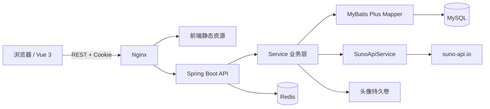
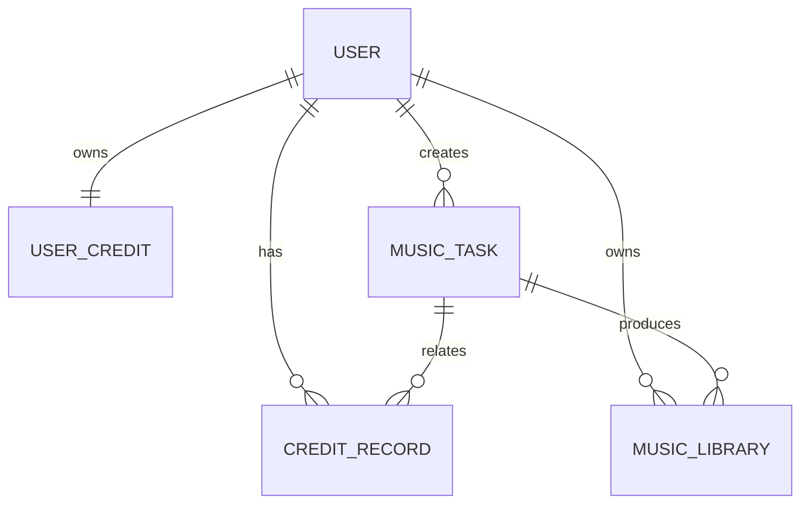
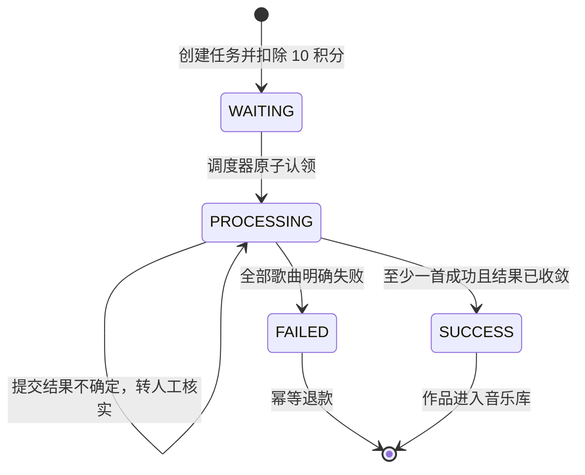

# 声序 AI 音乐工作台 V1 项目开发文档

> 文档版本：V1.0  
> 更新日期：2026-09-16  
> 项目目录：`D:\work\rinirnibishe`

## 1. 项目概述

“声序”是一套基于 Suno API 的 AI 音乐创作 Web 平台。V1 的目标不是提供单一 API 调用表单，而是建立一个包含用户身份、积分消费、异步生成任务、作品管理和持续播放器的完整音乐工作台。

V1 已覆盖以下核心闭环：

1. 用户注册、登录、退出和个人资料维护。
2. 输入歌曲描述并选择风格、情绪、人声、语言和歌词模式。
3. 使用积分创建音乐任务，并由后台异步提交到 Suno 服务。
4. 持续轮询上游结果，将一项任务产生的多首歌曲保存到音乐库。
5. 在音乐库中播放、查看歌词和参数、下载、软删除作品。
6. 在页面间保持播放器状态，退出登录时清理播放和用户状态。

## 2. V1 范围

### 2.1 已实现

- 登录、注册、退出、登录状态恢复。
- 用户名修改、头像上传、积分余额和积分流水。
- 首页、AI 音乐创作页、我的音乐库、个人中心、全局播放器。
- Prompt、音乐类型、情绪、人声、语言、歌词模式和自填歌词。
- 任务幂等创建、原子扣积分、异步提交、结果轮询、失败退款。
- 一个任务对应多首作品。
- Suno 自动歌词模式、自填歌词模式和结果查询适配。
- MySQL 持久化、Redis 会话与调度锁、Flyway 数据库迁移。
- JWT HttpOnly Cookie、CSRF 防护、用户数据归属校验。
- Docker Compose 本地部署、Nginx 反向代理和 Swagger UI。

### 2.2 暂不包含

- 支付充值、会员订阅和套餐系统。
- 音乐社区、评论、点赞、关注和公开分享。
- AI Agent、音乐编辑、混音、母带处理和音轨拆分。
- 多供应商模型路由和后台运营管理系统。
- 音频永久对象存储；V1 下载时转发上游音频地址。

## 3. 技术栈

### 3.1 前端

| 技术 | 用途 |
|---|---|
| Vue 3 | 页面与组件开发 |
| Vite | 开发服务器与生产构建 |
| TypeScript | 类型约束 |
| Element Plus | 表单、弹窗和基础交互组件 |
| Pinia | 用户状态与全局播放器状态 |
| Vue Router | 登录守卫与页面路由 |
| Axios | REST API 请求、Cookie 和 CSRF 处理 |

### 3.2 后端

| 技术 | 用途 |
|---|---|
| Java 21 | 后端运行时 |
| Spring Boot 3.4.5 | Web 与应用框架 |
| Spring Security | 登录鉴权、BCrypt、CSRF |
| MyBatis Plus 3.5.12 | 数据访问与分页 |
| MySQL 8 | 业务数据持久化 |
| Redis 7 | JWT 会话状态与调度锁 |
| Flyway | 数据库版本迁移 |
| JJWT | JWT 创建与解析 |
| Springdoc OpenAPI | Swagger API 文档 |
| Maven | 依赖管理和构建 |

### 3.3 部署

- Docker Compose 编排 MySQL、Redis、Spring Boot 和 Nginx。
- Nginx 承载前端静态资源，并代理 `/api`、`/uploads`、健康检查和 Swagger。
- MySQL、Redis 和头像文件均使用 Docker 命名卷持久化。

## 4. 系统架构



### 4.1 主要职责

- `controller`：接收请求、参数绑定、返回统一响应，不直接调用 Suno API。
- `service`：认证、用户、积分、任务、作品和上游适配业务。
- `mapper`：MyBatis Plus 数据访问，以及原子扣费、退款和任务认领 SQL。
- `entity`：数据库实体。
- `dto`：请求与响应对象。
- `config`：Security、JWT 过滤器、异常、MyBatis 和 Web 静态资源配置。
- `utils`：JWT 工具和业务异常。

## 5. 项目目录

```text
rinirnibishe/
├─ backend/
│  ├─ src/main/java/com/shengxu/
│  │  ├─ controller/
│  │  ├─ service/
│  │  ├─ mapper/
│  │  ├─ entity/
│  │  ├─ dto/
│  │  ├─ config/
│  │  └─ utils/
│  ├─ src/main/resources/
│  │  ├─ application.yml
│  │  └─ db/migration/V1__init.sql
│  ├─ Dockerfile
│  └─ pom.xml
├─ frontend/
│  ├─ src/
│  │  ├─ views/
│  │  ├─ components/
│  │  ├─ api/
│  │  ├─ store/
│  │  ├─ router/
│  │  └─ assets/
│  ├─ Dockerfile
│  ├─ nginx.conf
│  └─ package.json
├─ doc/
│  ├─ 项目开发文档.md
│  └─ API功能文档.md
├─ docker-compose.yml
├─ .env.example
└─ README.md
```

## 6. 前端页面与交互

### 6.1 登录与注册页

- 登录字段：邮箱、密码。
- 注册字段：用户名、邮箱、密码。
- 注册成功后自动登录，并赠送 100 积分。
- 登录成功后返回原目标路由。
- 已登录用户访问 `/login` 时自动跳转首页。

### 6.2 首页

- Hero 标题：“让 AI 创造你的下一首歌”。
- 提供开始创作入口。
- 展示六类精选模板，不伪造播放量或热度数据。
- 展示当前用户最近作品和产品功能说明。

### 6.3 AI 音乐创作页

支持的生成参数：

| 参数 | 可选值 |
|---|---|
| 音乐类型 | `Pop`、`Rock`、`HipHop`、`EDM`、`Lo-fi`、`古风` |
| 情绪 | `快乐`、`悲伤`、`治愈`、`热血` |
| 人声 | `MALE`、`FEMALE`、`INSTRUMENTAL` |
| 语言 | 中文、英文；纯音乐时可不传 |
| 歌词模式 | `AI`、`USER` |

交互规则：

- 纯音乐模式隐藏歌词和语言控制。
- 自填歌词且非纯音乐时，歌词不能为空。
- 表单草稿保存在浏览器本地。
- 创建任务时生成幂等键，防止重复提交和重复扣费。
- 页面只展示真实任务阶段，不伪造进度百分比。
- 刷新页面后通过本平台任务接口恢复状态。

### 6.4 我的音乐库

- 按当前用户隔离数据。
- 支持标题搜索和分页。
- 支持播放、歌词查看、生成参数查看、下载和确认删除。
- 删除为软删除，数据库记录保留并设置 `deleted = 1`。

### 6.5 个人中心

- 展示用户 ID、用户名、邮箱、头像和积分余额。
- 支持修改用户名。
- 支持上传 JPG、PNG、WebP 头像，单文件最大 3 MB。
- 展示积分赠送、消费和退款流水。

### 6.6 全局播放器

- 播放、暂停、进度拖动和音量调整。
- 切换页面时保持播放状态。
- 音频加载失败时显示反馈。
- 退出登录时停止播放并清空用户状态。

## 7. 数据库设计

Flyway 迁移文件 `backend/src/main/resources/db/migration/V1__init.sql` 是数据库结构的唯一事实来源。

### 7.1 表关系



### 7.2 `user`

| 字段 | 类型 | 说明 |
|---|---|---|
| id | BIGINT | 用户 ID，主键 |
| username | VARCHAR(40) | 唯一用户名 |
| email | VARCHAR(160) | 唯一邮箱，登录标识 |
| password_hash | VARCHAR(100) | BCrypt 密码哈希 |
| avatar_url | VARCHAR(500) | 头像访问路径 |
| created_at | DATETIME(3) | 创建时间 |
| updated_at | DATETIME(3) | 更新时间 |

### 7.3 `user_credit`

| 字段 | 类型 | 说明 |
|---|---|---|
| id | BIGINT | 主键 |
| user_id | BIGINT | 用户 ID，唯一关联 |
| balance | INT | 当前积分余额 |
| version | INT | 并发更新版本计数 |
| updated_at | DATETIME(3) | 更新时间 |

### 7.4 `credit_record`

| 字段 | 类型 | 说明 |
|---|---|---|
| id | BIGINT | 主键 |
| user_id | BIGINT | 用户 ID |
| task_id | BIGINT | 关联任务，可为空 |
| record_type | VARCHAR(20) | `GRANT`、`CONSUME`、`REFUND` |
| amount | INT | 本次变动，消费为负数 |
| balance_after | INT | 变动后余额 |
| business_no | VARCHAR(100) | 唯一业务编号，防止重复记账 |
| remark | VARCHAR(200) | 流水说明 |
| created_at | DATETIME(3) | 创建时间 |

### 7.5 `music_task`

| 字段 | 类型 | 说明 |
|---|---|---|
| id | BIGINT | 本地任务 ID |
| user_id | BIGINT | 所属用户 |
| idempotency_key | VARCHAR(64) | 用户维度唯一幂等键 |
| prompt | VARCHAR(2000) | 歌曲描述 |
| style | VARCHAR(80) | 音乐类型 |
| mood | VARCHAR(40) | 情绪 |
| vocal_type | VARCHAR(30) | 人声类型 |
| language | VARCHAR(20) | 歌曲语言 |
| lyrics_mode | VARCHAR(20) | `AI` 或 `USER` |
| input_lyrics | TEXT | 用户输入歌词 |
| song_title | VARCHAR(120) | 可选歌曲标题 |
| status | VARCHAR(30) | 业务状态 |
| submit_stage | VARCHAR(30) | 上游提交阶段 |
| cost | INT | 本次任务消耗积分 |
| provider_song_ids | VARCHAR(1000) | 上游歌曲 ID 列表 |
| error_message | VARCHAR(1000) | 异常信息 |
| next_poll_at | DATETIME(3) | 下次轮询时间 |
| poll_count | INT | 已轮询次数 |
| first_audio_url | VARCHAR(1000) | 首个成功音频摘要地址 |
| created_at / updated_at | DATETIME(3) | 创建及更新时间 |

### 7.6 `music_library`

| 字段 | 类型 | 说明 |
|---|---|---|
| id | BIGINT | 作品 ID |
| task_id | BIGINT | 来源任务 ID |
| user_id | BIGINT | 所属用户 |
| provider_song_id | VARCHAR(150) | 唯一上游歌曲 ID |
| status | VARCHAR(30) | 单曲状态 |
| title | VARCHAR(160) | 标题 |
| audio_url | VARCHAR(1000) | 上游音频地址 |
| cover_url | VARCHAR(1000) | 封面地址 |
| lyrics | MEDIUMTEXT | 歌词 |
| style_tags | VARCHAR(1000) | 上游风格标签 |
| duration | DECIMAL(10,3) | 时长，单位秒 |
| model_version | VARCHAR(40) | 模型版本 |
| error_message | VARCHAR(1000) | 单曲错误信息 |
| deleted | TINYINT(1) | 软删除标记 |
| created_at / updated_at | DATETIME(3) | 创建及更新时间 |

## 8. 积分一致性设计

- 注册用户初始赠送 100 积分。
- 每个音乐生成任务消耗 10 积分，一个任务即使返回多首歌也只扣一次。
- 创建任务、条件扣减余额、写入消费流水在同一数据库事务中完成。
- 扣费 SQL 带 `balance >= amount` 条件，可防止并发透支。
- 同一用户和同一幂等键只会创建一项任务。
- 全部上游歌曲明确失败时退款一次。
- 退款通过唯一 `business_no` 保证幂等。
- 只要存在成功作品，本次任务保留费用。
- 网络超时等无法判断上游是否已收费的情况进入待核实状态，不自动重复提交，也不自动退款。

## 9. 音乐任务生命周期



### 9.1 任务状态 `status`

| 状态 | 含义 |
|---|---|
| WAITING | 已入库，等待后台提交 |
| PROCESSING | 提交中、生成中、轮询中或待人工核实 |
| SUCCESS | 至少存在成功作品，结果已收敛 |
| FAILED | 全部结果明确失败，已触发退款 |

### 9.2 提交阶段 `submitStage`

| 阶段 | 含义 |
|---|---|
| CREATED | 已创建，尚未认领 |
| SUBMITTING | 调度器已原子认领，正在请求上游 |
| SUBMITTED | 已得到真实上游歌曲 ID，可安全轮询 |
| UNCERTAIN | 提交结果无法确认，停止自动重发并等待人工核实 |

## 10. Suno API 集成

所有上游调用集中在 `SunoApiService`，Controller 不直接访问 Suno。

### 10.1 自动歌词模式

- 上游接口：`POST /api/music/create`
- `prompt`、风格、情绪、语言和人声偏好组合为 `description`。
- `INSTRUMENTAL` 映射为 `instrumental = true`。

### 10.2 用户歌词模式

- 上游接口：`POST /api/music/create/custom`
- 映射 `lyrics`、`style_tags`、`song_title` 和 `vocal_gender`。
- Prompt 被加入风格描述。

### 10.3 异步查询

- 上游接口：`POST /api/music/query`
- `song_ids` 使用逗号分隔字符串。
- 默认模型：`suno-v6`。
- 创建请求使用 `wait_completion = false`。
- `pending:` 占位 ID 不进入查询接口。

### 10.4 调度策略

- 每 2 秒运行一次调度扫描。
- Redis 锁 `music:scheduler:lock` 防止多个后端实例同时调度。
- 每轮最多认领 5 个待提交任务、10 个待查询任务。
- 查询失败采用递增退避，最长 60 秒后重试。
- 前端只轮询本平台 API，刷新页面不会再次调用收费接口。

## 11. 安全设计

- 密码使用 BCrypt 哈希存储，数据库不保存明文密码。
- JWT 保存于 HttpOnly Cookie `SHENGXU_TOKEN`，默认有效期 7 天。
- Redis 保存 `session:{jti}`，退出登录后删除对应会话，可立即失效。
- Cookie 使用 `SameSite=Lax`；生产环境必须设置 `COOKIE_SECURE=true` 并启用 HTTPS。
- 除登录和注册外，写接口启用 CSRF 防护。
- 前端从 `XSRF-TOKEN` Cookie 读取令牌，并通过 `X-XSRF-TOKEN` 请求头发送。
- 任务、积分和作品接口均基于当前登录用户查询，越权访问统一表现为资源不存在。
- Suno API Key 仅从后端环境变量读取，不返回给浏览器。
- 下载接口只允许 HTTPS，且远程域名必须属于 `suno-api.io`、`suno.com` 或 `suno.ai` 的允许范围。

## 12. 环境变量

| 变量 | 必填 | 说明 |
|---|---|---|
| MYSQL_DATABASE | 是 | MySQL 数据库名 |
| MYSQL_USER | 是 | MySQL 业务用户 |
| MYSQL_PASSWORD | 是 | MySQL 业务用户密码 |
| MYSQL_ROOT_PASSWORD | 是 | MySQL root 密码 |
| JWT_SECRET | 是 | JWT 签名密钥，生产环境使用随机强密钥 |
| SUNO_API_KEY | 真实生成时必填 | Suno 服务密钥 |
| SUNO_BASE_URL | 否 | 默认 `https://www.suno-api.io` |
| SUNO_MODEL | 否 | 默认 `suno-v6` |
| COOKIE_SECURE | 生产环境必填 | HTTPS 环境设置为 `true` |
| UPLOAD_DIR | 否 | 头像存储目录 |

不要将 `.env`、API Key、数据库密码或 JWT 密钥提交到版本库。

## 13. 启动与部署

### 13.1 Docker Compose

1. 复制环境变量示例：

   ```powershell
   Copy-Item .env.example .env
   ```

2. 修改 `.env` 中的数据库密码和 `JWT_SECRET`。如需真实生成，再配置 `SUNO_API_KEY`。

3. 构建并启动：

   ```powershell
   docker compose up --build -d
   ```

4. 访问：

   - Web：<http://localhost:8098>
   - 健康检查：<http://localhost:8098/actuator/health>
   - Swagger UI：<http://localhost:8098/swagger-ui/index.html>

5. 停止服务：

   ```powershell
   docker compose down
   ```

`docker compose down` 不删除命名卷。只有在明确需要清空全部数据库、Redis 和上传文件时才使用 `docker compose down -v`。

### 13.2 本地开发

后端：

```powershell
Set-Location backend
mvn spring-boot:run
```

前端：

```powershell
Set-Location frontend
npm install
npm run dev
```

前端开发地址为 <http://localhost:5180>，Vite 将 `/api` 和 `/uploads` 代理到后端 `8090`。

## 14. 构建验证

后端：

```powershell
Set-Location backend
mvn -DskipTests package
```

前端：

```powershell
Set-Location frontend
npm run build
```

V1 不包含自动化测试代码。交付验收应重点检查：

- 注册、登录、退出和用户隔离。
- 注册赠送 100 积分。
- 未配置 Suno Key 时创建任务返回明确错误且不扣积分。
- 配置 Key 后仅进行一次人工生成测试，核对扣费、任务、多曲结果和下载。
- 桌面与移动端布局、路由、播放器和浏览器控制台。

## 15. 已知边界与后续扩展

- 真实 Suno 生成和上游音频下载会产生费用，V1 交付阶段未进行批量实测。
- `UNCERTAIN` 任务需要后续增加运营后台进行人工核实。
- 当前头像保存在本地卷，生产环境建议实现对象存储适配层。
- 当前作品音频未永久归档，依赖上游地址有效期。
- 数据库 ID 为 64 位整数。Web 客户端后续应统一将 ID 序列化为字符串，避免 JavaScript 超大整数精度问题。
- 后续可在现有 Service 和供应商适配层之上增加 AI Agent、社区、会员、更多模型及多供应商路由。

